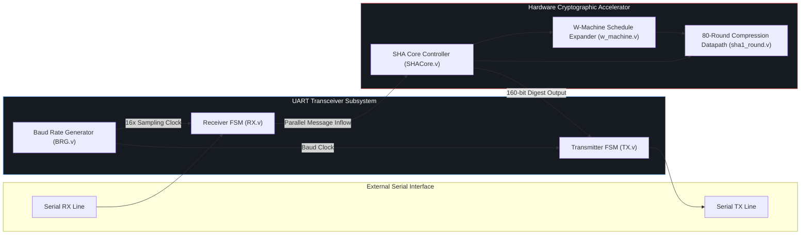

# UART Transceiver & Hardware SHA-1 Cryptographic Core in Verilog

A synthesizable, hardware-efficient implementation of a **full-duplex UART (Universal Asynchronous Receiver-Transmitter)** module coupled with an on-chip **SHA-1 hardware cryptographic hashing accelerator**, designed and simulated in Verilog HDL.

> ⚡ **Interactive Hardware Waveform & Cryptographic Visualizer:**  
> Simulate physical RS-232 bitstream pulse waveforms, clock-by-clock UART receiver FSM state progression, and 80-round SHA-1 hash register computation live in your browser:  
> **👉 [https://kshitij-garg.github.io/#uart](https://kshitij-garg.github.io/#uart)** (or [Standalone Full-screen](https://kshitij-garg.github.io/uart-simulator/))

---

## 🏗️ System Architecture

---

## ⚡ Core Subsystems

### 1. Baud Rate Generator ([`BRG.v`](BRG.v))
- Generates precise communication timing from the primary system clock.
- Produces both the $1\times$ transmission baud tick and a $16\times$ oversampling clock for robust receiver edge-detection and noise rejection.
- Baud Rate Formula:
  $$\text{Baud Rate} = \frac{f_{\text{sysclk}}}{16 \times \text{DIVISOR}}$$

### 2. Receiver Module ([`RX.v`](RX.v))
- Implements a finite state machine (FSM): `IDLE` $\to$ `START_BIT` $\to$ `DATA_BITS (8)` $\to$ `STOP_BIT`.
- Samples incoming serial data on the 8th count of the $16\times$ oversampled clock (mid-bit sampling) to avoid transition noise.
- Provides `data_ready` flag upon frame completion with framing error detection.

### 3. Transmitter Module ([`TX.v`](TX.v))
- Converts 8-bit parallel data from the core into asynchronous serial bitstreams: Start Bit (Logic 0), 8 Data Bits (LSB first), and 1 Stop Bit (Logic 1).
- Generates `tx_busy` and `tx_done` handshake signals.

### 4. SHA-1 Cryptographic Accelerator Core ([`SHACore.v`](SHACore.v), [`sha1_round.v`](sha1_round.v), [`w_machine.v`](w_machine.v))
- Hardware implementation of FIPS PUB 180-1 Secure Hash Algorithm 1.
- Processes 512-bit message blocks to compute a 160-bit cryptographic digest.
- Pipelined 80-round compression execution:
  - Rounds 0–19: $f_t(B, C, D) = (B \wedge C) \vee (\neg B \wedge D), \quad K_t = \text{0x5A827999}$
  - Rounds 20–39: $f_t(B, C, D) = B \oplus C \oplus D, \quad K_t = \text{0x6ED9EBA1}$
  - Rounds 40–59: $f_t(B, C, D) = (B \wedge C) \vee (B \wedge D) \vee (C \wedge D), \quad K_t = \text{0x8F1BBCDC}$
  - Rounds 60–79: $f_t(B, C, D) = B \oplus C \oplus D, \quad K_t = \text{0xCA62C1D6}$

---

## 🧪 Simulation & Testbenches

- **[`TB_UART.v`](TB_UART.v):** Verification testbench validating loopback serial communication, start/stop bit alignment, and clock division accuracy under noisy transmission boundaries.
- **[`TB_SHA.v`](TB_SHA.v):** Cryptographic verification testbench comparing digest outputs against standard NIST SHA-1 vector benchmarks.

---

## 🛠️ Verification & Tooling

- **Synthesis:** Designed for synthesis targeting Xilinx Spartan / Artix FPGA architectures.
- **Simulation:** Modelsim / Icarus Verilog compatible.

---

## 👨‍💻 Author & Connect

Developed by **[Kshitij Garg](https://github.com/kshitij-garg)**  
💼 **LinkedIn:** [linkedin.com/in/garg-kshitij](https://in.linkedin.com/in/garg-kshitij)
